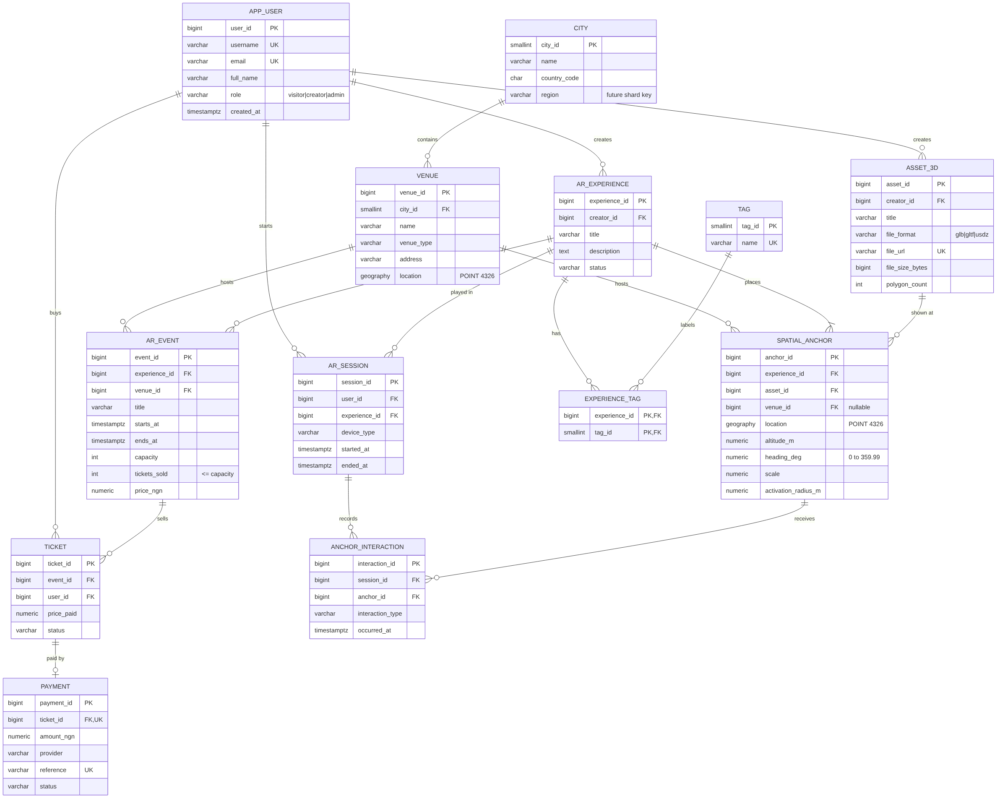

# Portfolio 1: Database Design and Modelling

Case study: SpatialHub, a location-based AR platform
Database: PostgreSQL 16 with PostGIS 3

## The organisation

SpatialHub is a simulated company. It runs a WebXR and mobile AR platform that pins 3D content to real places in Lagos, Abuja and London. People use it for heritage trails, museum guides, street tours and live AR events.

Here's how it works. A creator uploads 3D models (glTF, GLB or USDZ files) and builds an "experience" out of them. Each model in the experience is placed at a spatial anchor, which is basically a GPS point with an altitude, a direction it faces and a scale. When a visitor walks within range of an anchor, the model appears on their screen. Creators can also run live events with a fixed number of tickets.

**Who uses the database:** visitors, creators, admins, and the AR app itself, which reads nearby anchors and writes session data.

**Main data:** users, cities, venues, 3D assets, experiences, tags, spatial anchors, events, tickets, payments, AR sessions and anchor interactions.

**Main operations:** finding anchors near a user, publishing an experience, selling tickets without overselling, recording payments, logging sessions, and reporting on which content gets the most attention.

## ER diagram



The source for the diagram is in [er-diagram.mmd](er-diagram.mmd), and GitHub draws it from that file too.

The relationships, in plain terms:

- A creator owns many 3D assets and many experiences.
- An experience has one or more anchors, and each anchor shows one 3D asset.
- Experiences and tags are many to many, so there's a junction table called `experience_tag` in between.
- Cities contain venues, and venues host anchors and events. An anchor doesn't have to belong to a venue, since some just sit on a street.
- An event sells many tickets, and each ticket has at most one payment.
- A user starts many AR sessions, and each session records many interactions with anchors. This is the high volume table I use in Portfolio 2.

## Schema, keys and constraints

The full DDL is in [01_schema.sql](01_schema.sql).

| What | How I used it |
|---|---|
| Primary keys | Every table has an identity column as its key. `experience_tag` uses a composite key of `(experience_id, tag_id)`. |
| Foreign keys | 17 of them. I only used `ON DELETE CASCADE` where the child rows make no sense without the parent (tags on an experience, anchors, interactions). |
| Unique keys | email, username, file_url, payment reference, venue name within a city, and `(event_id, user_id)` so nobody buys two tickets to the same event. |
| CHECK constraints | Allowed values for roles, file formats, device types and statuses. Heading has to be between 0 and 360, scale above 0, an event has to end after it starts, and `tickets_sold` can't go above capacity. |
| Location | `GEOGRAPHY(POINT, 4326)`, so distances come back in metres instead of degrees. |

I went with surrogate keys instead of natural ones because things like email can change, and using them as keys would mean updating every table that points to them. The natural keys are still protected with UNIQUE constraints.

## Normalisation

I started from the kind of flat sheet a creator might keep before there was a database:

`(anchor_id, experience_title, creator_name, creator_email, asset_title, asset_format, venue_name, city, country, lat, lon, tags)`

| Step | Problem in the flat sheet | What I changed |
|---|---|---|
| 1NF | The tags column holds lists like "heritage, tourism". | Moved tags into their own table with a junction table, one row per tag per experience. Location became a single typed value instead of two loose numbers. |
| 2NF | In the junction table, a tag's name would only depend on `tag_id`, which is just half the key. | The junction table only keeps the two IDs. The tag name lives in `tag`. |
| 3NF | anchor gives venue, venue gives city, city gives country. Same with anchor, asset and creator email. | Split into `city`, `venue`, `asset_3d` and `app_user`, so every column depends only on its own table's key. |
| BCNF | Every determinant should be a candidate key. | I checked this. The only determinants left are primary keys and declared unique keys like email. |

There's one place where I denormalised on purpose: `ar_event.tickets_sold`. I could count tickets every time, but at checkout it's much simpler and faster to check and update one row. The risk is the number drifting out of sync, so I put a CHECK on it, and I test it properly under concurrency in Portfolio 3.

## How to run it

```bash
createdb spatialhub
psql -d spatialhub -f 01_schema.sql
psql -d spatialhub -f 02_seed_data.sql
psql -d spatialhub -f 03_verify_design.sql
```

If you use pgAdmin, run the first two in the Query Tool. The third one uses `\echo`, so it needs psql or the PSQL Tool in pgAdmin.

## Results

All 11 tables were created and filled. The test queries returned what I expected, for example 2 anchors within 1 km of Freedom Park in Lagos. Then I tried 8 inserts that should be impossible, and the database refused every one of them: a duplicate email, a role that doesn't exist, an anchor pointing to a missing asset, a heading of 400 degrees, an event that ends before it starts, a second ticket for the same person, an oversold event and a second payment for one ticket. The full output is in [results/03_verify_design_output.txt](results/03_verify_design_output.txt).

## Screenshots

| File | Shows |
|---|---|
| screenshots/p1-01-tables.png | The table list after running the schema |
| screenshots/p1-02-er-diagram.png | The ER diagram |
| screenshots/p1-03-nearby-anchors.png | The spatial query working |
| screenshots/p1-04-constraint-errors.png | The 8 rejected inserts |
