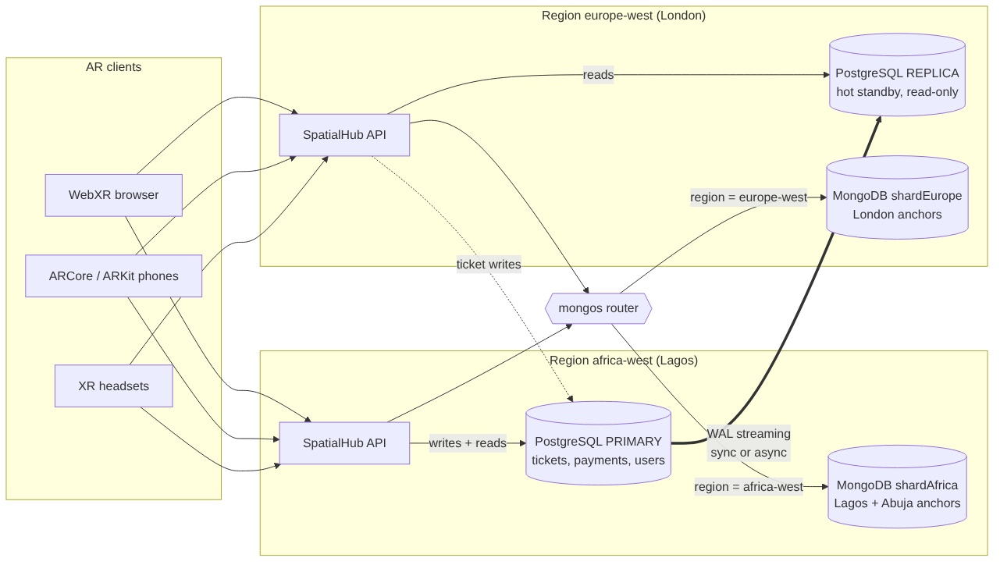

# Portfolio 5: Distributed and Cloud Databases

Case study: SpatialHub | Tools: PostgreSQL 16 streaming replication, MongoDB 8 sharded cluster with zones

## Why SpatialHub can't live on one server

- **Speed.** Anchors need to load before the user notices. Someone in London shouldn't have to wait for a round trip to Lagos every time they open a scene.
- **Staying up.** Live events happen at a set time. If the database goes down during the Heritage Night AR Walk, 50 people are standing in a park looking at nothing.
- **Where the data lives.** Nigeria's Data Protection Act 2023 and the UK GDPR both have rules about where personal data is handled. Keeping African users' location data on servers in Africa makes that a lot easier.
- **Growth.** Every new city adds more anchors and more telemetry, and at some point one machine won't cope.

## The plan



| Data | Where it goes | How it's spread out | Why |
|---|---|---|---|
| Tickets, payments, users | PostgreSQL | One primary, plus replicas that copy it | Money needs to be strongly consistent, so there's only one place that accepts writes |
| Anchors | MongoDB | Sharded by region, using zones | Each region's anchors sit on servers in that region |
| Telemetry | MongoDB time series | Sharded by region and session | Lots of writes and it's fine if it's a little behind |

## Exercise A: PostgreSQL replication and failover

Script: `01_pg_replication_demo.sh`, output in `results/01_pg_replication_output.txt`.

I set up a primary on port 5433 (playing the Lagos server) and a standby replica on port 5434 (playing London), using `pg_basebackup` and a replication slot. Then I ran through these tests:

| Test | What I checked | What happened |
|---|---|---|
| Replica set up | `pg_is_in_recovery()` on the replica | `t`, so it's running as a standby |
| Replication working | `pg_stat_replication` on the primary | Streaming, async, 0 bytes behind |
| Write on one, read on the other | Inserted "Lekki AR Art Fair" on the primary, then read the replica | It was there within a second |
| Replica is read only | Tried an UPDATE on the replica | Refused with "cannot execute UPDATE in a read-only transaction" |
| Synchronous mode | Set `synchronous_standby_names` | Status changed to sync, and each commit waited for the replica (about 2.4 ms locally) |
| Primary crash | Killed the primary with `pg_ctl stop -m immediate` | The primary was unreachable, but the replica still answered reads, including the last change I made in sync mode. Nothing was lost. |
| Failover | `SELECT pg_promote()` on the replica | It stopped being a replica and accepted a new write ("Post-failover event") |

**Async or sync?** With async replication, commits are as fast as possible, but if the primary dies, the last few transactions might never reach the replica. Sync means nothing gets lost, but every commit waits for the replica, and between Lagos and London that's around 100 ms each time. What I'd do: a sync standby in the same region (a second data centre in Lagos) for payments, and an async replica in London for disaster recovery and extra read capacity.

## Exercise B: MongoDB sharding by region

Script: `02_mongo_sharding_demo.py`, output in `results/02_mongo_sharding_output.txt`.

I built an actual sharded cluster on one machine: a config server, two shards (`shardAfrica` and `shardEurope`) and a `mongos` router. The shard key is `{ region: 1, _id: 1 }`, and I used zones to tie each region to its shard.

| Test | What happened |
|---|---|
| Loading 200,000 anchors through the router | 2.3 seconds |
| Where the data ended up (counted on each shard directly) | shardAfrica had 133,333 (Lagos 66,666 and Abuja 66,667). shardEurope had 66,667, all London. No African data ended up on the European shard. |
| Query that includes the region | Only went to shardAfrica (`SINGLE_SHARD`), returned 20 anchors |
| Query without the region (`experience_id: 42`) | Had to ask both shards and merge the answers (`SHARD_MERGE`), returned 62 |
| Shut down the London shard | Lagos and Abuja queries still worked. The London query timed out. |

**Choosing the shard key.** Region on its own would be a bad key because there are only 3 values, so the data can't be split into smaller chunks and each region becomes one huge chunk. `_id` on its own would send every new insert to the same shard, because new IDs always go at the end. Putting them together gives me both: region keeps each city's data in its own zone, and `_id` lets the chunks split inside a region. The test without the region also showed why the app's main queries should always include it. The app already knows the region from the phone's GPS, so that's easy.

**About the shard going down.** Sharding on its own only keeps you partly online. When London went down, only London was affected, but it was still down. In production each shard should be a replica set of 3 servers in different data centres, so losing one server just triggers an automatic election.

## Consistency and the CAP theorem

If the network between Lagos and London breaks, the system has to choose between staying consistent and staying available. I'd choose differently for each kind of data:

| Data | Choice | What happens if the link breaks |
|---|---|---|
| Tickets and payments | Consistency first (CP) | London can still read from its replica, but buying a ticket needs the Lagos primary. If it can't reach it, the purchase fails rather than risk overselling (see Portfolio 3). |
| Anchors and scenes | Availability first (AP) | Each region keeps serving its own data. A replica might be a few seconds behind, which doesn't matter much for 3D content. |
| Telemetry | Availability first, eventually consistent (BASE) | Writes go to the local shard and catch up later. That's fine for analytics. |

MongoDB lets you set this per operation. Important writes can use `writeConcern: {w: "majority"}` and `readConcern: "majority"`, and telemetry and scene reads can use `w: 1` with `readPreference: "nearest"`.

## Running it in the cloud

| Part | Managed service | How I'd set it up |
|---|---|---|
| PostgreSQL | Amazon RDS or Azure Database for PostgreSQL | Multi-AZ (a sync standby in a second data centre) in the main region, a read replica in London, automatic backups with point-in-time recovery, PostGIS turned on |
| MongoDB | MongoDB Atlas Global Cluster | The same zone setup as Exercise B, with each zone as a 3 node replica set. Africa on the nearest African region (for example AWS Cape Town) and Europe on AWS London. |
| 3D model files | Object storage with a CDN, like S3 and CloudFront | The databases only store the URLs, as designed in Portfolio 1 |
| Security | | TLS for connections, encryption at rest, private networking, database roles with only the permissions they need, IP allow lists |

Managed services save a lot of work on patching, backups and failover, but they cost more than running servers yourself and make it harder to switch providers. I'd start on the free Atlas tier and a small RDS instance, scale up first, and only start sharding once a single replica set isn't enough.

## Files and how to run them

| File | What it does |
|---|---|
| 01_pg_replication_demo.sh | Sets up the primary and replica and runs the replication and failover tests (Linux, macOS or WSL) |
| 02_mongo_sharding_demo.py | Sets up the sharded cluster and zones, loads the data, and runs the query and failure tests (needs `mongod` and `mongos`) |
| architecture.mmd and architecture.png | The architecture diagram |
| results/ | The output from both scripts |

```bash
bash 01_pg_replication_demo.sh
pip install pymongo && MONGO_BIN=/path/to/mongodb/bin python 02_mongo_sharding_demo.py
```

## Screenshots

| File | Shows |
|---|---|
| screenshots/p5-01-replication-status.png | Replication status, read only replica and sync mode |
| screenshots/p5-02-failover.png | The primary crashing, the replica being promoted, and the new write |
| screenshots/p5-03-shard-distribution.png | Documents per shard and the single shard vs both shards queries |
